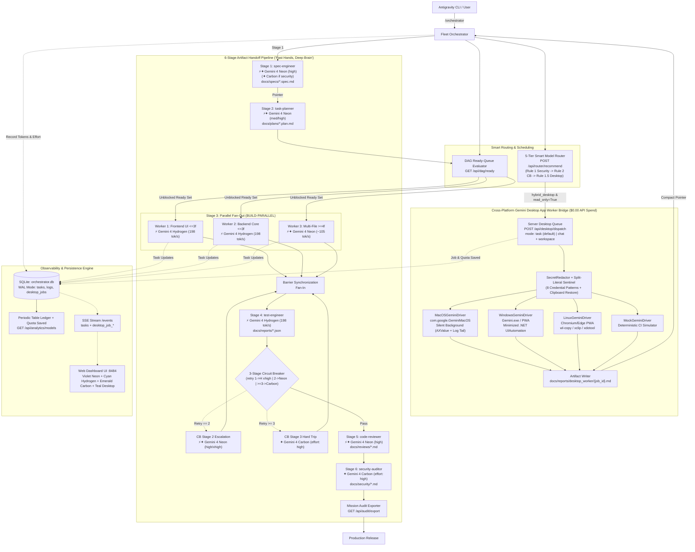

# Architecture Specification: Multi-Agent Orchestrator

## 1. System Overview

The **Multi-Agent Orchestrator** coordinates autonomous subagents under a bounded, **1-Agent = 1-Skill** paradigm with zero context bloat, 5-Tier Periodic Table dynamic model routing plus an External Heavy-Analysis Offload tier (`gemini-desktop-app`), condition-based parallel execution, Fast-Retry Circuit Breakers, and live SSE + SQLite telemetry.

---

## 2. Core Subsystems

### 2.1 State & Persistence Engine (SQLite 3)
- Thread-safe access via mutex-guarded standard library `sqlite3`.
- Active WAL (Write-Ahead Logging) mode and `synchronous=NORMAL` for concurrent non-blocking readers and writer.
- **Non-Destructive Schema Migration**:
  - Automatically adds `reasoning_effort TEXT DEFAULT NULL` to the `tasks` table if absent upon startup.
  - Supports `xhigh` effort level.
  - Generates index `idx_tasks_model` on `tasks(model)` for sub-millisecond per-model aggregation queries.
- Persistent tables:
  * `tasks`: Stores `task_id`, `agent_type`, `model`, `reasoning_effort`, `complexity`, `status`, `progress`, `scope`, `notes`, `conv_id`, `depends_on`, `parallel_group`, `input_tokens`, `output_tokens`, `cache_tokens`, `total_tokens`, `created_at`, `updated_at`.
  * `logs`: Time-series event stream capped at 1000 items with levels (`info`, `warn`, `error`, `thought`).
  * `desktop_jobs`: Persistent FIFO queue and audit history for Desktop Worker executions (`job_id`, `task_id`, `status`, `os_platform`, `driver_name`, `app_path`, `prompt_chars`, `prompt_preview`, `redaction_count`, `redactions_json`, `artifact_path`, `summary_excerpt`, `output_chars`, `duration_ms`, `estimated_saved_usd`, `estimated_saved_vnd`, `clipboard_restored`, `error_message`, `created_at`, `started_at`, `completed_at`).

### 2.2 Periodic Table SWE Fleet Routing Subsystem (`MODEL_REGISTRY`)
The runtime matches task requirements against the Periodic Table capability and financial tiers:

| Tier | Canonical Name | Target Personas | Pricing (In / Out / Cache per 1M) | Supported Reasoning Efforts | Rationale |
|---|---|---|---|:---:|---|
| **Tier 1: Frontier Security** | `gemini-4-carbon` | `security-auditor`, `critical` specs/debugging, CB Stage 3 | **$2.00 / $10.00 / $0.50** *(+$4/$20 Dec 1)* | `low`, `medium`, `high` | Rule 1 Frontier security audits (OWASP/auth/crypto/CVE/migration) and final Stage 3 Circuit Breaker escalation (`retry >= 3`). |
| **Tier 1.5 / 2: SWE Frontier (`mid_frontier`)** | `gemini-4-neon` | `orchestrator` (`gemini-pro-orchestrator-neon`), `spec-engineer`, `task-planner`, `code-reviewer`, `debugger`, `performance-auditor`, `builder` (`>=4` files) | **$3.00 / $15.00 / $0.15** *(95% off)* | `low`, `medium`, `high`, `xhigh` | Element #10: Coding Agent Index #1 (`58.64`), Intelligence `61`, `~105 tok/s` (2x Argon/Carbon speed), ~32% lower cost/task than Carbon. Replaces Argon & handles CB Stage 2 (`retry == 2`). |
| **Tier 2b: Legacy Deep Reasoning** | `gemini-4-argon` | Legacy compatibility & fallback only | **$1.25 / $5.00 / $0.3125** *(+$4/$20 Dec 1)* | `low`, `medium`, `high` | Superseded by `gemini-4-neon` across SWE routing; retained for historical ledger rows. |
| **Tier 3: High-Throughput Workhorse** | `gemini-4-hydrogen` | `builder` (`<=3` files), `test-engineer`, `scout`, `ui-builder` | **$1.50 / $7.50 / $0.075** *(95% off)* | `low`, `medium`, `high`, `xhigh` | Speed-optimized workhorse (198 tok/s, ~2x faster than Neon without ~40s TTFT); saves ~24% quota when paired with `Orchestrator (Neon)`. |
| **Tier 4: Cost-Efficient & Active Micro-Tier** | `gemini-3.8-flash` | `code-simplifier`, `doc-generator`, `observability`, `cost_saving` builders | **$0.75 / $3.75 / $0.075** *(live)* | `low`, `medium`, `high` | Active default (`low`) for cost-first bulk execution, docs, and micro-tier telemetry (replaces absent `3.8-flash-lite` default). |
| **Tier 5: Deprecated Alias** | `gemini-3.8-flash-lite` | Historical DB rows only | **$0.0375 / $0.15 / $0.01** | `None` | Absent from live `swarm` inventory; kept strictly as registry alias. |

- **Smart Model Recommender (`recommend_model`)**:
  - Evaluates persona, complexity (`low`, `medium`, `high`, `critical`), `file_count`, security impact, retry count, `budget_mode` (`balanced`, `speed_first`, `latency_sensitive`, `quality_first`, `cost_saving`, `hybrid_desktop`, `offload_heavy_to_desktop`), `desktop_available`, `read_only`, and `prefer_desktop`.
  - **Rule 1 (Strict Security Guardrail)**: Any task with `has_security_impact=True`, `complexity == "critical"`, `security-auditor`, or cryptographic/auth/OWASP/CVE/migration keywords strictly forces `gemini-4-carbon` (`effort: high`, `fallback_model: "gemini-4-neon"`).
  - **Rule 2 (3-Stage Circuit Breaker)**: `retry_count == 1` uses `gemini-4-hydrogen` (`xhigh`), `retry_count == 2` escalates to **`gemini-4-neon`** (`high`/`xhigh`), and `retry_count >= 3` trips hard to **`gemini-4-carbon`** (`high`).
  - **Rule 1.5 (Desktop Offload & Conditional 60% Peer Gate)**: Evaluated after Rule 1 (Security Guardrail) & Rule 2 (Circuit Breaker). Under `hybrid_desktop` / `offload_heavy_to_desktop` or `allocate-dag` (`ORCHESTRATOR_DESKTOP_SHARE=0.60`), when `desktop-doctor` / `GET /api/desktop/status` reports `ready == true` (macOS or Windows), `gemini-desktop-app` acts as a first-class peer model (`mode="task"`, `background=True`, `allow_edits=True/False`, `0` focus switches, `$0.00` AGY API spend) for sequential heavy stages (`spec-engineer`, `task-planner`, `code-reviewer`, `debugger`, `performance-auditor`, `doc-generator`) plus at most 1 heavy builder per `parallel_group`. When `ready == false` or `--no-desktop` / `--api-only` is passed, routing automatically falls back 100% to the pure API fleet (`Gemini 4 Neon` + `Gemini 4 Hydrogen` + `Gemini 4 Carbon` + `Gemini 3.8 Flash`).

### 2.3 Cross-Platform Gemini Desktop App Worker Bridge (`desktop_worker.py`)
- **Silent Background Execution (`background=True` Default & `--allow-foreground` Opt-in)**:
  * **`background=True` (`--background`, Default)**: Runs with zero window focus theft (`0%` interruption while the user continues working in other apps) and zero clipboard mutation on macOS and Windows.
  * **`--allow-foreground` (Opt-in Only)**: Disabled by default; required only once when registering a brand-new unbookmarked workspace folder via the macOS `NSOpenPanel` (`Add new folder…`) sheet.
- **Interaction Modes (`--mode task` Default vs. `--mode chat`) & Direct Workspace Binding (`--workspace`)**:
  * **`Task` Mode (`--mode task`, Default)**: Selects `Task` mode in `Gemini.app` and binds `--workspace <path>` (auto-defaults to `os.getcwd()`) directly via `Folders` (`ConnectedFolderNSMenu`). Because `Gemini.app` reads the mounted workspace directly from disk, AGY agents do not need to copy huge source files into prompts — concise prompts referencing relative paths suffice.
  * **`Chat` Mode (`--mode chat`)**: Uses standard standalone chat without attaching a local workspace folder, suited for self-contained prompts or conceptual reviews.
  * **Execution Scope Contract (`allow_edits=True/False`)**: Analytical stages run with `allow_edits=False` (strictly read-only inspection, zero workspace mutations, avoiding interactive confirmation dialogs) and emit structured findings inside the Sentinel envelope to `docs/reports/desktop_worker/{job_id}.md`. At most 1 heavy builder slice per `parallel_group` may run with `allow_edits=True` on a strictly disjoint file slice when `ready == true`.
- **Stdlib-Only OS Drivers (`BaseDesktopDriver`)**:
  * `MacOSGeminiDriver` (`macos_ax`, `darwin`): Discovers `com.google.GeminiMacOS` / `com.google.gemini` via `plistlib`, `mdfind`, and canonical `/Applications/Gemini.app` or PWA paths; verifies screen lock (`CGSSessionScreenIsLocked`) and `AXIsProcessTrustedWithOptions(null)`; ensures a usable `OmnichatWindow` with **0 focus switches** (via `AXMenuBar -> File -> Open App` + `AXHidden=True` when closed or in `MinichatWindow`); selects `Task` (default) or `Chat` mode and mounts `--workspace` via daemon-thread `AXPress` on `Folders` (`ConnectedFolderNSMenu`, zero `CGEvent` cursor movement); injects prompts via direct `AXValue` write + `AXPress` submit (zero synthetic keystrokes, zero clipboard touch); passively monitors `AXHidden` `OmnichatWindow` + `~/Library/Caches/com.google.GeminiMacOS/Logs/diagnostic*.log` (`removeStreamingConversation()` / `agentModeTask: ended` + Task-mode quiet debounce, `0` focus jumps across intermediate turns); and extracts verbatim responses from `AXStaticText.AXDescription` / `AXButton.AXDescription`.
  * `WindowsGeminiDriver` (`windows_uia`, `win32`): Discovers `%LOCALAPPDATA%\Programs\Gemini\Gemini.exe`, Start Menu `.lnk` / `Get-StartApps`, or Edge/Chrome PWA; executes static PowerShell (`-NoProfile -NonInteractive -Sta -WindowStyle Minimized -ExecutionPolicy Bypass -Command -`) using pure `.NET System.Windows.Automation` (`ValuePattern` + `InvokePattern` + `TextPattern`) with **`0` `SetForegroundWindow`, `0` `SendKeys`, and `0` `Clipboard`** via a private `0600` temp file (`AGY_DESKTOP_PROMPT_FILE`).
  * `LinuxGeminiDriver` (`linux_pwa`, `linux`): Detects `$DISPLAY`/`$WAYLAND_DISPLAY`, Chromium/Chrome/Edge `--app=https://gemini.google.com`, `wl-copy`/`xclip`/`xsel`, and `xdotool`/`wtype`; fails gracefully on headless hosts with `--driver mock` remediation.
  * `MockGeminiDriver` (`mock`): Zero-GUI deterministic simulator for CI/tests (`MOCK_DELAY_MS`, `[MOCK_TIMEOUT]`, `[MOCK_ERROR]`, `[MOCK_PARTIAL]`, `[MOCK_CHROME]`).
- **Security & Correctness Invariants**:
  * **Zero `shell=True` & Zero Prompt Interpolation**: All OS scripts are static and receive dynamic data strictly via `stdin`, `argv`, or `0600` env-referenced temp files.
  * **Pre-Flight `SecretRedactor`**: Scrubs 8 credential categories (Google/LLM/GitHub/AWS keys, JWT, PEM private keys, DB DSNs, Bearer/KV credentials) before injection or SQLite preview storage; `strict_secrets=True` aborts (`rejected_secrets`).
  * **Zero-Clipboard Silent Mode & Clipboard Save/Restore Invariant**: Default `background=True` execution on macOS (`AXValue` + `AXStaticText.AXDescription`) and Windows (`ValuePattern` + `TextPattern`) never touches the OS clipboard; fallback paths (`Cmd+V` / `Cmd+Shift+C` / `linux_pwa`) restore prior clipboard contents inside `try...finally` immediately (`<= 300ms`).
  * **Split-Literal Sentinel Protocol**: `SentinelEnvelope.build_prompt()` splits `"<<<AGY_DESKTOP_DONE:"` + `f"{job_id}>>>"` so echoed user prompts never trigger premature completion; completion requires busy-control absence, sentinel boundaries after `--- TASK CONTEXT ---`, and `>= 500ms` stability debounce.
  * **Single-Window Mutex & Path Traversal Guard**: Serializes GUI access via `threading.Lock` + `fcntl.flock`/`msvcrt.locking` + FIFO queue, and restricts `output_path` strictly inside `<workspace_root>/docs/reports`.
- **REST Endpoints, CLI & Quota Saved Accounting**:
  * Endpoints: `GET /api/desktop/status`, `POST /api/desktop/dispatch` (accepts `mode: "task" | "chat"`, `workspace: "."`, `background: true`, `allow_foreground: false`, `allow_edits: false`), `GET /api/desktop/jobs`, `GET /api/desktop/jobs/{job_id}`, `POST /api/desktop/cancel`, `POST /api/desktop/jobs/{job_id}/cancel`, `POST /api/router/allocate-dag`, plus SSE `desktop_job_*` events.
  * CLI (`client.py`): `desktop-doctor` (`desktop-status`), `allocate-dag --target-desktop-share 0.60 --apply` (`--no-desktop` / `--api-only`), `desktop-ask --mode task --workspace . --background` (`desktop-dispatch`, plus opt-in `--allow-foreground` for first-time `NSOpenPanel` folder registration), `desktop-jobs`, `desktop-cancel`.
  * Accounting: `compute_desktop_quota_saved()` estimates `ceil(chars / 4)` tokens against `gemini-4-carbon` baseline rates (`$2.00` in / `$10.00` out per 1M) as **AGY Quota Saved** (`usd` & `vnd`), while actual AGY API cost remains `$0.00`.

### 2.4 Conditional 60% `gemini-desktop-app` Peer Allocation Policy (`allocate-dag`)
1. **Pre-Flight Detection Gate (`desktop-doctor` / `GET /api/desktop/status`)**:
   - **When `ready == true` (macOS or Windows)**: `gemini-desktop-app` operates as a **first-class peer model** (`mode="task"`, `background=True`, `allow_edits=True/False`, `0` focus switches, `$0.00` AGY API token spend) prioritized for **~60% of total SWE workload** (`ORCHESTRATOR_DESKTOP_SHARE=0.60`):
     - **Sequential Heavy Stages**: `spec-engineer`, `task-planner`, `code-reviewer`, `debugger`, `performance-auditor`, and `doc-generator`.
     - **Single-Window FIFO Lock Protection**: Allocates **at most 1 heavy builder per `parallel_group`** to `gemini-desktop-app`, ensuring `Gemini.app`'s single-window FIFO lock NEVER blocks concurrent Fan-Out.
     - **Concurrent ~40% AGY API Fleet**: `gemini-4-hydrogen` (`198 tok/s`) executes sibling parallel builders, `test-engineer`, and `scout`; `gemini-4-neon` handles spillover when the Desktop queue is busy; and `gemini-4-carbon` (`high`) remains strictly locked on **Rule 1 Security Audits**.
   - **When `ready == false` (missing app or locked screen)** — or `--no-desktop` / `--api-only` is passed: Automatically and seamlessly falls back **100% to the pure API fleet (`Gemini 4 Neon` + `Gemini 4 Hydrogen` + `Gemini 4 Carbon` + `Gemini 3.8 Flash`)** with zero manual intervention.
2. **CLI & REST Interface**:
   - CLI: `ORCHESTRATOR_DESKTOP_SHARE=0.60 python3 packages/orchestrator/client.py allocate-dag --target-desktop-share 0.60 --apply` (override with `--no-desktop` or `--api-only`).
   - REST: `POST /api/router/allocate-dag` (`{"target_desktop_share": 0.60, "apply": true, "no_desktop": false}`).

---

## 3. "Fast Hands, Deep Brain" Multi-Agent Topologies

### 3.1 Topology Pattern A: Scout-Then-Architect (Token Minimization)
1. **Hydrogen Scouts**: Fast reconnaissance workers run ripgrep and AST checks at 198 tok/s.
2. **Compact Pointers**: Return only URI references (`file:///...#L10-L40`) and summary structures.
3. **Neon Synthesis**: The architect (`gemini-4-neon`, `~105 tok/s`) ingests < 4,000 prompt tokens (80% reduction), drafting architecture with zero context bloat at 2x Argon speed.

### 3.2 Topology Pattern B: Fan-Out Hydrogen Builders + Neon Brain + Carbon Security Gate
1. **Parallel Execution**: Bounded disjoint builders (`<= 3` files) execute simultaneously on `gemini-4-hydrogen` at 198 tok/s (~24% quota saved with `Orchestrator (Neon)`), while multi-file refactors (`>= 4` files) run on `gemini-4-neon`.
2. **High-Speed Testing**: Test suites run on `gemini-4-hydrogen`.
3. **Dual Quality Gate**: Code is inspected across 5 quality axes by `gemini-4-neon` (`high`), followed by OWASP security fuzzing by `gemini-4-carbon` (`high`).

### 3.3 Topology Pattern C: 3-Stage Fast-Retry & Escalation Circuit Breaker
- **Attempt 0 (`retry_count: 0`)**: Task runs on `gemini-4-hydrogen` (`medium` or `high` effort).
- **Stage 1 (`retry_count: 1`)**: 1 fast self-healing turn on `gemini-4-hydrogen` (`xhigh` effort).
- **Stage 2 (`retry_count: 2`)**: Escalates to **Gemini 4 Neon** (`high`, or `xhigh` if `complexity == "high"`).
- **Stage 3 (`retry_count >= 3`) or Security Impact**: Trips circuit breaker hard to **Gemini 4 Carbon** (`reasoning_effort: high`) for final frontier root-cause diagnosis.

### 3.4 Context Cache Economics
- `gemini-4-hydrogen` (`$0.075 / 1M`) and `gemini-4-neon` (`$0.15 / 1M`) both deliver a **95% cache read discount** off input token rates.
- Repeated builder and reviewer turns referencing long architecture specifications save massive operational cost (~32% lower cost/task on Neon vs Carbon).

---

## 4. Condition-Based DAG Ready-Queue Evaluator
- Evaluates task prerequisite relationships via `depends_on`.
- Endpoint `GET /api/dag/ready` identifies all `pending` tasks whose prerequisite tasks are all `completed`.
- Automatically sets `can_fan_out = True` when two or more tasks are ready to run concurrently, identifying the target `fan_out_group`.
- Ensures the **Decoupled File Scope Invariant**: parallel builder workers must only edit non-overlapping file sets.

---

## 5. Per-Model Financial Analytics & Token Telemetry
- Measures:
  * Prompt Tokens (`input_tokens`)
  * Completion Tokens (`output_tokens`)
  * Antigravity Cache Read Tokens (`cache_tokens`)
  * Total Token Footprint
  * Cache Hit Rate Percentage (`cache_tokens / (input_tokens + cache_tokens) * 100`)
- Financial Calculation:
  * Converts token usage to actual USD cost based on `MODEL_REGISTRY` rates.
  * Calculates cache savings: `baseline_cost_without_cache - actual_cost`.
  * Multiplies by the fixed exchange rate `USD_TO_VND_RATE = 25400.0` for local currency reporting.
- Endpoint `GET /api/analytics/models` provides per-model breakdowns across all 5 tiers.

---

## 6. Mission Audit Exporter
- Endpoint `GET /api/audit/export?format=markdown|json` and CLI `client.py export`.
- Compiles the full execution transcript:
  1. 5-Tier Per-Model Consumption & Financial Ledger table.
  2. Complete Task Execution Matrix with status, reasoning efforts (`xhigh`), progress, and file scopes.
  3. Verification and compliance signatures.

---

## 7. Reliability & Zero-Dependency Guarantees
- Strictly uses standard library Python 3.10+: `sqlite3`, `http.server`, `urllib`, `json`, `argparse`, `threading`, `time`.
- No external Python package managers or pip installations required (`requirements.txt` is empty/stdlib-only).
- Web Dashboard is rendered as a standalone vanilla HTML/JS single-page application with embedded SVG graphs, Tailwind CSS, **Neon Violet (`#a855f7`) badges for Neon (`gemini-pro-orchestrator-neon`)**, electric cyan badges for Hydrogen, and emerald badges for Carbon.
