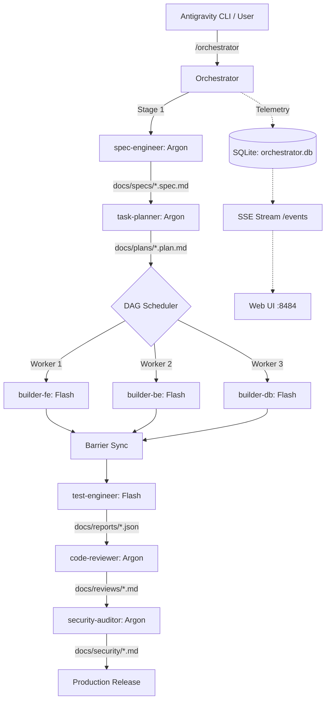

# Architecture Specification: Multi-Agent Orchestrator

## 1. System Overview

The Multi-Agent Orchestrator coordinate autonomous subagents under a bounded, 1-Agent = 1-Skill paradigm with zero context bloat, dynamic model tiering, condition-based parallel execution, and live SSE + SQLite telemetry.

## 2. Core Subsystems

### 2.1 State & Persistence Engine (SQLite)
- Thread-safe access via mutex-guarded standard library `sqlite3`.
- WAL (Write-Ahead Logging) mode and `synchronous=NORMAL` for concurrent readers and writer.
- Persistent tables:
  * `tasks`: Stores state, progress (0-100), model tier, complexity, dependencies, parallel groups, and token counts.
  * `logs`: Time-series event stream capped at 1000 items.

### 2.2 Dynamic Model Selection & Tiering Matrix
- **Gemini 4 Argon (`model: gemini-4-argon`, `pro`)**: High-reasoning persona tasks requiring strict precision (Architecture, Code Review, Security Audits, Root-Cause Debugging).
- **Gemini 3.8 Flash (`model: gemini-3.8-flash`, `flash`)**: High-throughput implementation persona tasks (UI/API implementation, unit tests, code cleanup).

### 2.3 Parallel Worker Execution (Fan-Out / Fan-In)
- **Decoupled File Scope Invariant**: Workers run concurrently only when operating on disjoint, non-overlapping file boundaries.
- **DAG Execution**: Workers are triggered once all dependencies in `depends_on` are satisfied.

### 2.4 Token & Cache Telemetry
- Measures:
  * Input tokens (Prompt)
  * Output tokens (Completion)
  * Cache tokens read (Antigravity Context Cache Hit)
  * Grand total footprint
  * Cache Hit Rate percentage
