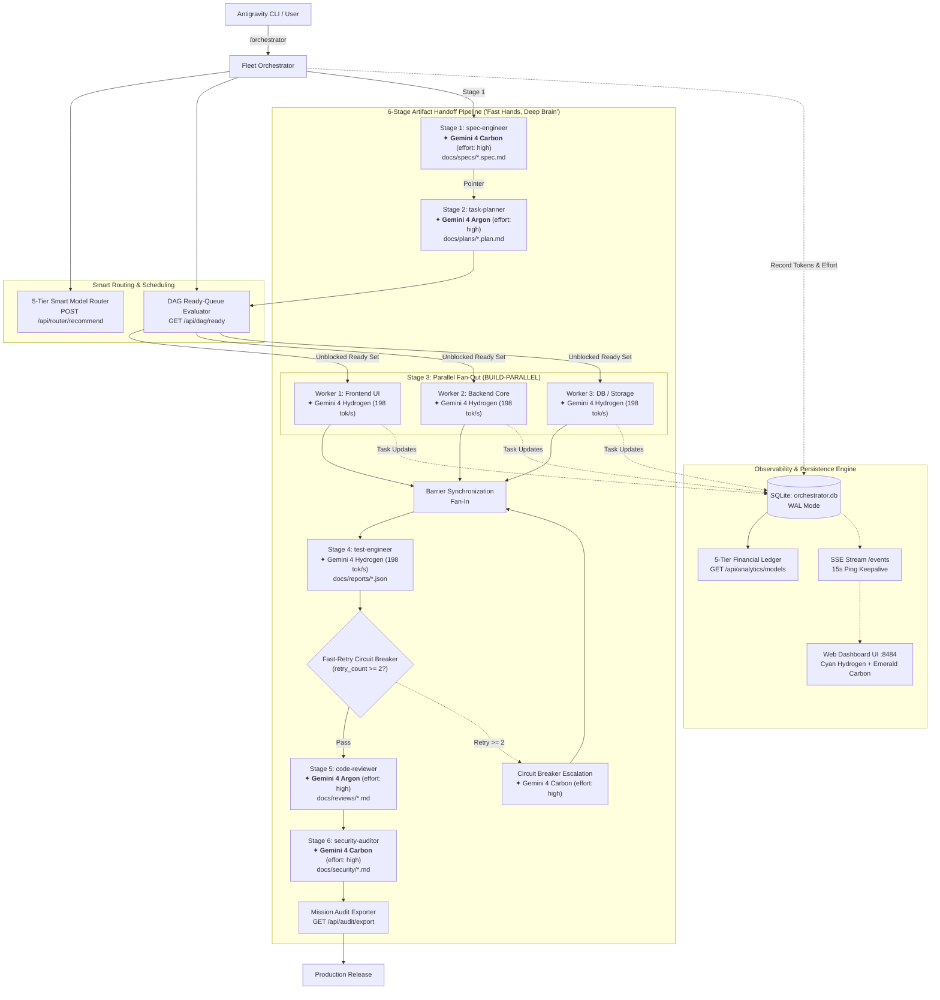

# Architecture Specification: Multi-Agent Orchestrator

## 1. System Overview

The **Multi-Agent Orchestrator** coordinates autonomous subagents under a bounded, **1-Agent = 1-Skill** paradigm with zero context bloat, 5-Tier Periodic Table dynamic model routing, condition-based parallel execution, Fast-Retry Circuit Breakers, and live SSE + SQLite telemetry.

---

## 2. Core Subsystems

### 2.1 State & Persistence Engine (SQLite 3)
- Thread-safe access via mutex-guarded standard library `sqlite3`.
- Active WAL (Write-Ahead Logging) mode and `synchronous=NORMAL` for concurrent non-blocking readers and writer.
- **Non-Destructive Schema Migration**:
  - Automatically adds `reasoning_effort TEXT DEFAULT NULL` to the `tasks` table if absent upon startup.
  - Supports `xhigh` effort level.
  - Generates index `idx_tasks_model` on `tasks(model)` for sub-millisecond per-model aggregation queries.
- Persistent tables:
  * `tasks`: Stores `task_id`, `agent_type`, `model`, `reasoning_effort`, `complexity`, `status`, `progress`, `scope`, `notes`, `conv_id`, `depends_on`, `parallel_group`, `input_tokens`, `output_tokens`, `cache_tokens`, `total_tokens`, `created_at`, `updated_at`.
  * `logs`: Time-series event stream capped at 1000 items with levels (`info`, `warn`, `error`, `thought`).

### 2.2 5-Tier Periodic Table Intelligent Model Routing Subsystem (`MODEL_REGISTRY`)
The runtime matches task requirements against five distinct capability and financial tiers:

| Tier | Canonical Name | Target Personas | Pricing (In / Out / Cache per 1M) | Supported Reasoning Efforts | Rationale |
|---|---|---|---|:---:|---|
| **Tier 1: Frontier** | `gemini-4-carbon` | `security-auditor`, `spec-engineer`, `debugger` | **$2.00 / $10.00 / $0.50** | `low`, `medium`, `high` | Google Frontier model for deep multi-pass reasoning, autonomous verification loops, and vulnerability fuzzing. |
| **Tier 2: Deep Reasoning** | `gemini-4-argon` | `task-planner`, `code-reviewer`, `orchestrator` | **$1.25 / $5.00 / $0.3125** | `low`, `medium`, `high` | High-velocity deep reasoning for architectural topology, DAG scheduling, and 5-axis code reviews. |
| **Tier 3: High-Throughput Workhorse** | `gemini-4-hydrogen` | `builder`, `test-engineer`, `scout`, `ui-builder` | **$1.50 / $7.50 / $0.075** | `low`, `medium`, `high`, `xhigh` | Speed-optimized workhorse (198 tok/s, 2.5x speed) with 95% cache savings for parallel builders and test suites. |
| **Tier 4: Cost-Efficient** | `gemini-3.8-flash` | `code-simplifier`, `doc-generator` | **$0.075 / $0.30 / $0.01875** | `None` | Ultra-fast parallel code generation and scaffolding in cost-first mode (>70% cost savings). |
| **Tier 5: Ultra-Fast Micro-Tier** | `gemini-3.8-flash-lite` | `observability-and-instrumentation` | **$0.0375 / $0.15 / $0.01** | `None` | Micro-tier for telemetry heartbeats, linting, and doc formatting. |

- **Smart Model Recommender (`recommend_model`)**:
  - Evaluates persona, complexity (`low`, `medium`, `high`, `critical`), security impact, retry count, and budget mode (`balanced`, `speed_first`, `latency_sensitive`, `quality_first`, `cost_saving`).
  - Strict Security Guardrail: Any task with security impact or cryptographic/auth keywords strictly forces `gemini-4-carbon` (`effort: high`).
  - Circuit Breaker: Escalates to `gemini-4-carbon` when `retry_count >= 2`.

---

## 3. "Fast Hands, Deep Brain" Multi-Agent Topologies

### 3.1 Topology Pattern A: Scout-Then-Architect (Token Minimization)
1. **Hydrogen Scouts**: Fast reconnaissance workers run ripgrep and AST checks at 198 tok/s.
2. **Compact Pointers**: Return only URI references (`file:///...#L10-L40`) and summary structures.
3. **Argon Synthesis**: The architect ingests < 4,000 prompt tokens (80% reduction), drafting architecture with zero context bloat.

### 3.2 Topology Pattern B: Fan-Out Hydrogen Builders + Dual Quality Gate
1. **Parallel Execution**: Up to 8 disjoint builders execute simultaneously on `gemini-4-hydrogen` at 198 tok/s.
2. **High-Speed Testing**: Test suites run on `gemini-4-hydrogen`.
3. **Dual Quality Gate**: Code is inspected across 5 quality axes by `gemini-4-argon`, followed by OWASP security fuzzing by `gemini-4-carbon`.

### 3.3 Topology Pattern C: Fast-Retry & Escalation Circuit Breaker
- **Attempt 0 (`retry_count: 0`)**: Task runs on `gemini-4-hydrogen` (`medium` or `high` effort).
- **Attempt 1 (`retry_count: 1`)**: 1 fast self-healing turn on `gemini-4-hydrogen` (`xhigh` effort).
- **Attempt 2+ (`retry_count >= 2`)**: Trip circuit breaker! Reassigns task to **Gemini 4 Carbon** (`reasoning_effort: high`) for deep root-cause diagnosis.

### 3.4 Context Cache Economics
- `gemini-4-hydrogen` features a context cache read rate of **$0.075 / 1M tokens**, delivering a **95% discount** off input tokens ($1.50).
- Repeated builder turns referencing long architecture specifications save massive operational cost.

---

## 4. Condition-Based DAG Ready-Queue Evaluator
- Evaluates task prerequisite relationships via `depends_on`.
- Endpoint `GET /api/dag/ready` identifies all `pending` tasks whose prerequisite tasks are all `completed`.
- Automatically sets `can_fan_out = True` when two or more tasks are ready to run concurrently, identifying the target `fan_out_group`.
- Ensures the **Decoupled File Scope Invariant**: parallel builder workers must only edit non-overlapping file sets.

---

## 5. Per-Model Financial Analytics & Token Telemetry
- Measures:
  * Prompt Tokens (`input_tokens`)
  * Completion Tokens (`output_tokens`)
  * Antigravity Cache Read Tokens (`cache_tokens`)
  * Total Token Footprint
  * Cache Hit Rate Percentage (`cache_tokens / (input_tokens + cache_tokens) * 100`)
- Financial Calculation:
  * Converts token usage to actual USD cost based on `MODEL_REGISTRY` rates.
  * Calculates cache savings: `baseline_cost_without_cache - actual_cost`.
  * Multiplies by the fixed exchange rate `USD_TO_VND_RATE = 25400.0` for local currency reporting.
- Endpoint `GET /api/analytics/models` provides per-model breakdowns across all 5 tiers.

---

## 6. Mission Audit Exporter
- Endpoint `GET /api/audit/export?format=markdown|json` and CLI `client.py export`.
- Compiles the full execution transcript:
  1. 5-Tier Per-Model Consumption & Financial Ledger table.
  2. Complete Task Execution Matrix with status, reasoning efforts (`xhigh`), progress, and file scopes.
  3. Verification and compliance signatures.

---

## 7. Reliability & Zero-Dependency Guarantees
- Strictly uses standard library Python 3.10+: `sqlite3`, `http.server`, `urllib`, `json`, `argparse`, `threading`, `time`.
- No external Python package managers or pip installations required (`requirements.txt` is empty/stdlib-only).
- Web Dashboard is rendered as a standalone vanilla HTML/JS single-page application with embedded SVG graphs, Tailwind CSS, electric cyan badges for Hydrogen, and emerald badges for Carbon.
