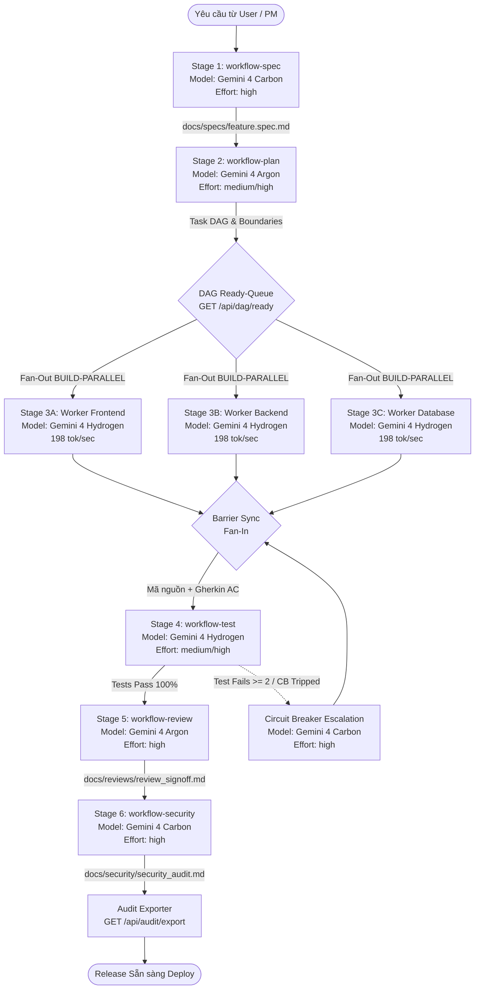

# Hướng Dẫn Chuỗi Workflow Liên Hoàn (Chained Multi-Agent Pipeline)

Tài liệu chi tiết về cơ chế bàn giao Input/Output, hệ thống định tuyến mô hình 5 tầng (**5-Tier Periodic Table Intelligent Model Routing**), cơ chế Fast-Retry Circuit Breaker, hàng đợi sẵn sàng DAG tự động, và nghiệm thu kiểm toán giữa các agent trong đội ngũ phát triển.

---

## 1. Nguyên Lý Thiết Kế Cốt Lõi

Thay vì nạp toàn bộ lịch sử chat hàng nghìn dòng vào từng subagent (gây loãng ngữ cảnh, hallucination và lãng phí token), hệ thống áp dụng 5 nguyên lý bất biến:
1. **Pointers Over Copies:** Agent trước tạo ra một tập tin kết quả (Artifact). Agent sau chỉ được cấp đường dẫn URI con trỏ tới tập tin đó (`file:///...`).
2. **Hợp Đồng Dữ Liệu Nghiêm Ngặt:** Mỗi giai đoạn có cấu trúc thư mục quy chuẩn (`docs/specs`, `docs/plans`, `docs/reports`, `docs/reviews`, `docs/security`).
3. **Định Tuyến Model 5 Tầng Bảng Tuần Hoàn (5-Tier Periodic Table Routing):**
   - ✦ **Tier 1: Gemini 4 Carbon** (`gemini-4-carbon`, `reasoning_effort: high`): Dành cho Stage 1 (Spec PRD phức tạp) và Stage 6 (Kiểm toán bảo mật chuyên sâu OWASP/Auth/Crypto). Giá: $2.00 / $10.00 / $0.50.
   - ✦ **Tier 2: Gemini 4 Argon** (`gemini-4-argon`, `reasoning_effort: medium/high`): Dành cho Stage 2 (Kiến trúc & Task DAG) và Stage 5 (Review chất lượng 5 trục). Giá: $1.25 / $5.00 / $0.3125.
   - ✦ **Tier 3: Gemini 4 Hydrogen** (`gemini-4-hydrogen`, `reasoning_effort: low/medium/high/xhigh`): Ngựa thồ tốc độ cao (198 tok/s, nhanh hơn 2.5x) dành cho Stage 3 (Parallel Builder) và Stage 4 (Automated Testing), tiết kiệm 95% chi phí đọc cache ($0.075 / 1M tokens).
   - ⚡ **Tier 4: Gemini 3.8 Flash** (`gemini-3.8-flash`): Dành cho triển khai số lượng lớn ở chế độ `cost_saving` và tinh gọn văn bản. Giá: $0.075 / $0.30 / $0.01875.
   - ⚡ **Tier 5: Gemini 3.8 Flash-Lite** (`gemini-3.8-flash-lite`): Dành cho telemetry micro-tier, logging nhịp tim, và linting nhanh. Giá: $0.0375 / $0.15 / $0.01.
4. **Mô Hình "Fast Hands, Deep Brain" & Fast-Retry Circuit Breaker:**
   - Hydrogen trinh sát và viết code thần tốc (198 tok/s); Argon định hình kiến trúc; Carbon chốt chặn an ninh mạng tối cao.
   - Nếu gặp lỗi: Hydrogen tự sửa nhanh đúng 1 lượt với mức tư duy tối đa `xhigh`. Nếu vẫn thất bại (`retry_count >= 2`), kích hoạt ngắt mạch (Circuit Breaker) tự động leo thang lên Gemini 4 Carbon (`high` effort) để chẩn đoán gốc rễ.
5. **Phân Tách Phạm Vi File Tuyệt Đối (Decoupled File Scope Invariant):** Các worker thực thi song song trong Stage 3 chỉ được phép chỉnh sửa các file thuộc phạm vi được giao, tuyệt đối không ghi đè lên file của worker khác.

---

## 2. Bản Đồ 6 Giai Đoạn (Chained Pipeline Graph)



---

## 3. Danh Sách Thư Mục Artifacts Quy Chuẩn

Mỗi dự án sau khi chạy `./install.sh` sẽ duy trì cấu trúc tài liệu đồng nhất:
```
docs/
├── specs/       # Nơi lưu trữ tài liệu đặc tả (Output Stage 1 - Gemini 4 Carbon)
├── plans/       # Nơi lưu trữ kiến trúc kỹ thuật & Task DAG (Output Stage 2 - Gemini 4 Argon)
├── reports/     # Nơi lưu trữ kết quả kiểm thử tự động JSON (Output Stage 4 - Gemini 4 Hydrogen)
├── reviews/     # Nơi lưu trữ biên bản nghiệm thu code review (Output Stage 5 - Gemini 4 Argon)
└── security/    # Nơi lưu trữ báo cáo quét bảo mật OWASP (Output Stage 6 - Gemini 4 Carbon)
```

---

## 4. Chi Tiết Từng Giai Đoạn

| Giai Đoạn | Tên Slash Command | Persona | Model Khuyến Nghị | Mức Tư Duy | Artifact Đầu Ra |
| :---: | :--- | :--- | :---: | :---: | :--- |
| **Stage 1** | `/workflow-spec` | `spec-engineer` | ✦ **Gemini 4 Carbon** | `high` | `docs/specs/{feature_id}.spec.md` |
| **Stage 2** | `/workflow-plan` | `task-planner` | ✦ **Gemini 4 Argon** | `high` | `docs/plans/{feature_id}.plan.md` |
| **Stage 3** | `/workflow-build` | `builder` (1..N) | ✦ **Gemini 4 Hydrogen** | `medium` / `high` / `xhigh` | Mã nguồn trên các file tách biệt (198 tok/s) |
| **Stage 4** | `/workflow-test` | `test-engineer` | ✦ **Gemini 4 Hydrogen** | `medium` / `high` | `docs/reports/test_report.json` |
| **Stage 5** | `/workflow-review` | `code-reviewer` | ✦ **Gemini 4 Argon** | `high` | `docs/reviews/review_signoff.md` |
| **Stage 6** | `/workflow-security`| `security-auditor`| ✦ **Gemini 4 Carbon** | `high` | `docs/security/security_audit.md` |

---

## 5. Vận Hành Trong Phiên Làm Việc Antigravity (`agy`)

### 5.1 Sử Dụng Slash Commands Tương Tác
Trong khung chat của Antigravity CLI, bạn chỉ cần gõ `/`:
- `/orchestrator`: Khởi chạy toàn bộ hệ thống điều phối, kiểm tra trạng thái dashboard.
- `/workflow-pipeline`: Chạy pipeline liên hoàn xuyên suốt từ Spec đến Security.
- `/workflow-spec`: Chỉ định agent làm rõ yêu cầu thành spec với Gemini 4 Carbon.
- `/workflow-plan`: Lập kế hoạch kiến trúc và chia task song song với Gemini 4 Argon.
- `/workflow-build`: Cho phép các worker implement code song song trên Gemini 4 Hydrogen (198 tok/s).
- `/workflow-test`: Chạy bộ test kiểm thử tự động với Gemini 4 Hydrogen.
- `/workflow-review`: Thực hiện review 5 trục chất lượng với Gemini 4 Argon.
- `/workflow-security`: Thực hiện quét bảo mật sâu với Gemini 4 Carbon.

### 5.2 Sử Dụng CLI Telemetry & Ready-Queue (`client.py`)
```bash
# 1. Đề xuất model tối ưu với budget-mode và retry-count
python3 packages/orchestrator/client.py recommend \
  --agent builder \
  --complexity medium \
  --budget-mode speed_first \
  --retry-count 0

# Nhiệm vụ bảo mật luôn được định tuyến về Gemini 4 Carbon
python3 packages/orchestrator/client.py recommend \
  --agent security-auditor \
  --complexity critical \
  --security-impact

# 2. Khám phá các task đã sẵn sàng chạy trong DAG
python3 packages/orchestrator/client.py next-ready

# 3. Cập nhật task kèm theo model Gemini 4 Hydrogen và mức tư duy xhigh
python3 packages/orchestrator/client.py update \
  --task BUILD-01 \
  --agent builder \
  --model gemini-4-hydrogen \
  --reasoning-effort high \
  --status running \
  --progress 20 \
  --scope "src/components/Dashboard.tsx" \
  --notes "Building frontend view at 198 tok/sec"

# 4. Khi hoàn thành task:
python3 packages/orchestrator/client.py update \
  --task BUILD-01 \
  --agent builder \
  --model gemini-4-hydrogen \
  --status completed \
  --progress 100 \
  --input-tokens 24000 \
  --output-tokens 1800 \
  --cache-tokens 65000 \
  --notes "Passed compile and syntax check"

# 5. Xuất biên bản nghiệm thu kiểm toán:
python3 packages/orchestrator/client.py export --format markdown --out docs/reports/mission_audit_report.md
```
