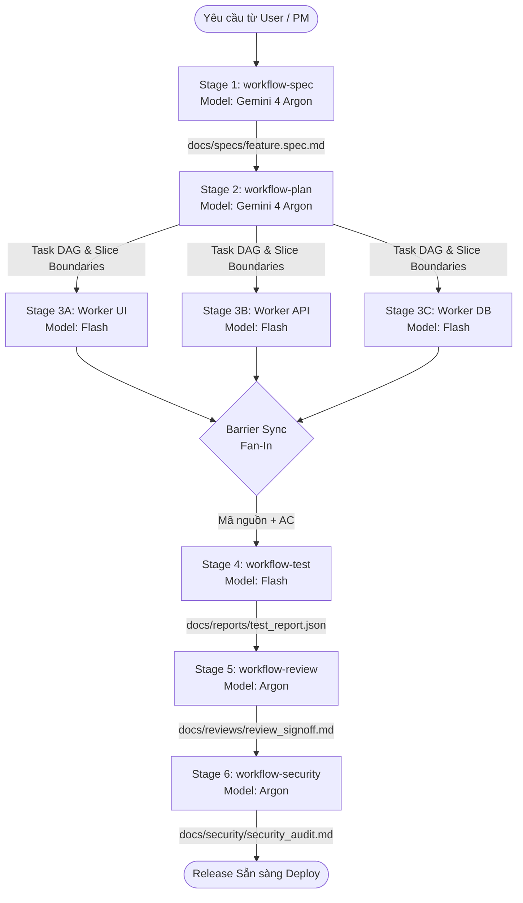

# Hướng dẫn Chuỗi Workflow Liên hoàn (Chained Pipeline)

Tài liệu chi tiết về cơ chế bàn giao Input/Output giữa các agent trong đội ngũ phát triển.

---

## 1. Nguyên lý Thiết kế: 1-Agent = 1-Skill & Zero Context Bloat

Thay vì nạp toàn bộ lịch sử chat hàng nghìn dòng vào từng subagent (gây loãng ngữ cảnh, hallucination và tốn token), hệ thống áp dụng cơ chế:
1. **Pointers Over Copies:** Agent trước tạo ra một tập tin kết quả (Artifact). Agent sau chỉ được cấp đường dẫn trỏ tới tập tin đó (`file:///...`).
2. **Hợp đồng dữ liệu nghiêm ngặt:** Mỗi giai đoạn có cấu trúc thư mục và định dạng JSON/Markdown được quy chuẩn.
3. **Định tuyến Model thông minh:**
   - Các giai đoạn tư duy kiến trúc, bảo mật, review: **Gemini 4 Argon** (`gemini-4-argon`, reasoning cao).
   - Các giai đoạn thực thi code, viết test: **Gemini 3.8 Flash** (`gemini-3.8-flash`, tốc độ cao, tiết kiệm chi phí).

---

## 2. Bản đồ 6 Giai đoạn



---

## 3. Danh sách Thư mục Artifacts Quy chuẩn

Mỗi dự án sau khi chạy `./install.sh` sẽ có cấu trúc thư mục tài liệu:
```
docs/
├── specs/       # Nơi lưu trữ tài liệu đặc tả (Output Stage 1)
├── plans/       # Nơi lưu trữ kiến trúc kỹ thuật & Task DAG (Output Stage 2)
├── reports/     # Nơi lưu trữ kết quả kiểm thử tự động JSON (Output Stage 4)
├── reviews/     # Nơi lưu trữ biên bản nghiệm thu code review (Output Stage 5)
└── security/    # Nơi lưu trữ báo cáo quét bảo mật OWASP (Output Stage 6)
```

---

## 4. Cách Thực thi trong Phiên làm việc Antigravity

### Cách 1: Sử dụng Slash Command Tương tác
Trong khung chat của Antigravity, bạn chỉ cần gõ `/`:
- `/orchestrator`: Khởi chạy toàn bộ hệ thống điều phối.
- `/workflow-pipeline`: Chạy pipeline liên hoàn xuyên suốt từ Spec đến Security.
- `/workflow-spec`: Chỉ định agent làm rõ yêu cầu thành spec.
- `/workflow-plan`: Lập kế hoạch kiến trúc và chia task song song từ spec.
- `/workflow-build`: Cho phép worker implement code theo kế hoạch.
- `/workflow-test`: Chạy test kiểm thử tự động.
- `/workflow-review`: Thực hiện review 5 trục.
- `/workflow-security`: Thực hiện quét bảo mật.

### Cách 2: Theo dõi Live trên Dashboard
Mở trình duyệt tại: `http://localhost:8484` để theo dõi:
- Tiến độ từng worker theo thời gian thực (Server-Sent Events).
- Tiêu hao Token (Input, Output, Cache Read).
- Lịch sử logs và cảnh báo lỗi.
