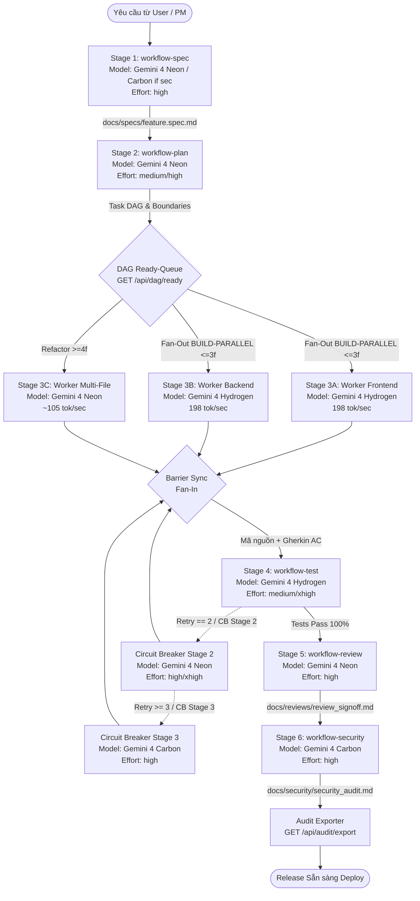

# Hướng Dẫn Chuỗi Workflow Liên Hoàn (Chained Multi-Agent Pipeline)

Tài liệu chi tiết về cơ chế bàn giao Input/Output, hệ thống định tuyến mô hình 5 tầng (**5-Tier Periodic Table Intelligent Model Routing**), cơ chế Fast-Retry Circuit Breaker, hàng đợi sẵn sàng DAG tự động, và nghiệm thu kiểm toán giữa các agent trong đội ngũ phát triển.

---

## 1. Nguyên Lý Thiết Kế Cốt Lõi

Thay vì nạp toàn bộ lịch sử chat hàng nghìn dòng vào từng subagent (gây loãng ngữ cảnh, hallucination và lãng phí token), hệ thống áp dụng 5 nguyên lý bất biến:
1. **Pointers Over Copies:** Agent trước tạo ra một tập tin kết quả (Artifact). Agent sau chỉ được cấp đường dẫn URI con trỏ tới tập tin đó (`file:///...`).
2. **Hợp Đồng Dữ Liệu Nghiêm Ngặt:** Mỗi giai đoạn có cấu trúc thư mục quy chuẩn (`docs/specs`, `docs/plans`, `docs/reports`, `docs/reviews`, `docs/security`).
3. **Định Tuyến Model Bảng Tuần Hoàn Tối Ưu SWE (Gemini 4 Neon Fleet Routing):**
   - ✦ **Tier 1: Gemini 4 Carbon** (`gemini-4-carbon`, `reasoning_effort: high`): Khóa chặt cho Stage 6 (Kiểm toán bảo mật chuyên sâu OWASP/Auth/Crypto/CVE/Migration), các Spec có `has_security_impact=True` / `complexity="critical"`, và Circuit Breaker Stage 3 (`retry_count >= 3`). Giá: $2.00 / $10.00 / $0.50 *(tăng lên $4/$20 từ 01/12/2026)*.
   - ⚡✦ **Tier 1.5 / 2: Gemini 4 Neon** (`gemini-4-neon` / `gemini-pro-orchestrator-neon`, `reasoning_effort: low/medium/high/xhigh` - MỚI): Nguyên tố #10 — Coding Agent Index #1 (`58.64`), Intelligence `61`, tốc độ `~105 tok/s` (gấp 2x Carbon/Argon). **Thay thế hoàn toàn `gemini-4-argon`** ở `orchestrator`, Stage 2 (`task-planner`), Stage 5 (`code-reviewer`), và **đảm nhận** Stage 1 phi bảo mật (`spec-engineer`), `debugger`, `performance-auditor`, `builder` đa file (`>= 4` files), và Circuit Breaker Stage 2 (`retry_count == 2`) với chi phí/tác vụ thấp hơn ~32% so với Carbon. Giá: **$3.00 / $15.00 / $0.15** (tiết kiệm 95% cache).
   - ✦ **Tier 2b: Gemini 4 Argon** (`gemini-4-argon`): Đã được thay thế bởi `gemini-4-neon` trong luồng SWE mặc định; giữ lại cho tương thích lịch sử & fallback dự phòng.
   - ⚡ **Tier 3: Gemini 4 Hydrogen** (`gemini-4-hydrogen`, `reasoning_effort: low/medium/high/xhigh`): Đôi tay tốc độ cao (**198 tok/s**, nhanh gấp ~2x Neon, tránh TTFT ~40s) ghép đôi cùng `Orchestrator (Neon)` (tiết kiệm ~24% quota) cho Stage 3 (`builder <= 3` files), Stage 4 (`test-engineer`), và `scout`. Giá: $1.50 / $7.50 / $0.075 (tiết kiệm 95% cache).
   - ⚡ **Tier 4: Gemini 3.8 Flash** (`gemini-3.8-flash`, `low`): Mặc định hiện hành cho `cost_saving`, scaffolding, `doc-generator`, `code-simplifier`, và telemetry/linting (thay thế `gemini-3.8-flash-lite` không có trong runtime thực tế). Giá live: $0.75 / $3.75 / $0.075.
   - 🖥️ **External Heavy-Analysis Offload (`gemini-desktop-app` — MỚI)**: Cầu nối Gemini Desktop App cục bộ (`macos_ax` / `windows_uia` / `linux_pwa` / `mock`) cho phép offload các tác vụ phân tích chỉ đọc dung lượng lớn (`spec-engineer`, `task-planner`, `code-reviewer`, `debugger` với `read_only=True`) ở chế độ `hybrid_desktop` / `offload_heavy_to_desktop` với **$0.00 chi phí API AGY**. Mặc định chạy **Thực Thi Nền Im Lặng (`--background`, `background=True`) — 0 lần nhảy app (`0` focus switches)**: trên macOS mở/duy trì `OmnichatWindow` với `AXHidden=True` qua `AXMenuBar -> File -> Open App` (`0` `AXFrontmost`), dùng daemon-thread `AXPress` chọn `Folders` (`0` `CGEvent`), ghi trực tiếp `AXValue` + bấm gửi `AXPress` (`0` gõ phím, `0` chạm clipboard), theo dõi thụ động `OmnichatWindow` & `~/Library/Caches/com.google.GeminiMacOS/Logs/diagnostic*.log` (`removeStreamingConversation()` / `agentModeTask: ended` + debounce chống nhảy khi chuyển tool turn), và trích xuất nguyên văn `AXStaticText.AXDescription`; trên Windows dùng thuần `.NET UIAutomation` (`ValuePattern` + `InvokePattern` + `TextPattern`) với `-WindowStyle Minimized` (`0` `SetForegroundWindow`, `0` `SendKeys`, `0` `Clipboard`). Mặc định dùng **`Task` mode (`--mode task`)** gắn trực tiếp thư mục dự án (`--workspace <path>`, mặc định `os.getcwd()`) qua `Folders` (`ConnectedFolderNSMenu`) để đọc mã nguồn theo đường dẫn tương đối (chỉ cần `--allow-foreground` đúng 1 lần khi đăng ký thư mục mới chưa có bookmark qua `NSOpenPanel` `Add new folder…`), hoặc chuyển `--mode chat` cho prompt độc lập. Tất cả chỉnh sửa mã nguồn Stage 3 vẫn chạy song song trên `gemini-4-hydrogen` (`<= 3` files) / `gemini-4-neon` (`>= 4` files), còn kiểm toán bảo mật luôn khóa chặt trên `gemini-4-carbon`.
4. **Mô Hình "Fast Hands, Deep Brain" & 3-Stage Fast-Retry Circuit Breaker:**
   - Hydrogen trinh sát và viết code phạm vi gọn (`<= 3` files) ở 198 tok/s; **Gemini 4 Neon** định hình kiến trúc, spec, review 5 trục và refactor đa file (`>= 4` files); **Gemini 4 Carbon** chốt chặn an ninh mạng tối cao.
   - Cơ chế tự phục hồi 3 tầng: Stage 1 (`retry_count == 1`) Hydrogen tự sửa 1 lượt với mức tư duy tối đa `xhigh`; Stage 2 (`retry_count == 2`) leo thang lên **Gemini 4 Neon** (`high`/`xhigh`); Stage 3 (`retry_count >= 3` hoặc chạm bảo mật) ngắt mạch cứng lên **Gemini 4 Carbon** (`high` effort).
5. **Phân Tách Phạm Vi File Tuyệt Đối (Decoupled File Scope Invariant):** Các worker thực thi song song trong Stage 3 chỉ được phép chỉnh sửa các file thuộc phạm vi được giao, tuyệt đối không ghi đè lên file của worker khác.

---

## 2. Bản Đồ 6 Giai Đoạn (Chained Pipeline Graph)



---

## 3. Danh Sách Thư Mục Artifacts Quy Chuẩn

Mỗi dự án sau khi chạy `./install.sh` sẽ duy trì cấu trúc tài liệu đồng nhất:
```
docs/
├── specs/       # Nơi lưu trữ tài liệu đặc tả (Output Stage 1 - Gemini 4 Neon / Carbon nếu bảo mật)
├── plans/       # Nơi lưu trữ kiến trúc kỹ thuật & Task DAG (Output Stage 2 - Gemini 4 Neon)
├── reports/     # Nơi lưu trữ kết quả kiểm thử tự động JSON (Output Stage 4 - Gemini 4 Hydrogen)
│   └── desktop_worker/  # Báo cáo phân tích chỉ đọc từ Gemini Desktop App Worker ({job_id}.md)
├── reviews/     # Nơi lưu trữ biên bản nghiệm thu code review (Output Stage 5 - Gemini 4 Neon)
└── security/    # Nơi lưu trữ báo cáo quét bảo mật OWASP (Output Stage 6 - Gemini 4 Carbon)
```

---

## 4. Chi Tiết Từng Giai Đoạn

| Giai Đoạn | Tên Slash Command | Persona | Model Khuyến Nghị | Mức Tư Duy | Artifact Đầu Ra |
| :---: | :--- | :--- | :---: | :---: | :--- |
| **Stage 1** | `/workflow-spec` | `spec-engineer` | ⚡✦ **Gemini 4 Neon** *(✦ Carbon nếu bảo mật)* | `high` | `docs/specs/{feature_id}.spec.md` |
| **Stage 2** | `/workflow-plan` | `task-planner` | ⚡✦ **Gemini 4 Neon** | `medium` / `high` | `docs/plans/{feature_id}.plan.md` |
| **Stage 3** | `/workflow-build` | `builder` (1..N) | ⚡ **Hydrogen** (`<=3` files) / ⚡✦ **Neon** (`>=4` files) | `medium` / `high` / `xhigh` | Mã nguồn trên các file tách biệt (`198` / `~105` tok/s) |
| **Stage 4** | `/workflow-test` | `test-engineer` | ⚡ **Gemini 4 Hydrogen** | `medium` (`xhigh` retry 1) | `docs/reports/test_report.json` |
| **Stage 5** | `/workflow-review` | `code-reviewer` | ⚡✦ **Gemini 4 Neon** | `high` | `docs/reviews/review_signoff.md` |
| **Stage 6** | `/workflow-security`| `security-auditor`| ✦ **Gemini 4 Carbon** | `high` | `docs/security/security_audit.md` |

---

## 5. Vận Hành Trong Phiên Làm Việc Antigravity (`agy`)

### 5.1 Sử Dụng Slash Commands Tương Tác
Trong khung chat của Antigravity CLI, bạn chỉ cần gõ `/`:
- `/orchestrator`: Khởi chạy toàn bộ hệ thống điều phối, kiểm tra trạng thái dashboard.
- `/workflow-pipeline`: Chạy pipeline liên hoàn xuyên suốt từ Spec đến Security.
- `/workflow-spec`: Chỉ định agent làm rõ yêu cầu thành spec với **Gemini 4 Neon** (hoặc **Gemini 4 Carbon** nếu có yếu tố bảo mật/critical).
- `/workflow-plan`: Lập kế hoạch kiến trúc và chia task song song với **Gemini 4 Neon**.
- `/workflow-build`: Cho phép các worker implement code song song trên **Gemini 4 Hydrogen** (`<= 3` files, 198 tok/s) hoặc **Gemini 4 Neon** (`>= 4` files).
- `/workflow-test`: Chạy bộ test kiểm thử tự động với **Gemini 4 Hydrogen**.
- `/workflow-review`: Thực hiện review 5 trục chất lượng với **Gemini 4 Neon**.
- `/workflow-security`: Thực hiện quét bảo mật sâu với **Gemini 4 Carbon**.

### 5.2 Sử Dụng CLI Telemetry & Ready-Queue (`client.py`)
```bash
# 1. Đề xuất model tối ưu với budget-mode và retry-count
python3 packages/orchestrator/client.py recommend \
  --agent builder \
  --complexity medium \
  --budget-mode speed_first \
  --retry-count 0

# Nhiệm vụ bảo mật luôn được định tuyến về Gemini 4 Carbon
python3 packages/orchestrator/client.py recommend \
  --agent security-auditor \
  --complexity critical \
  --security-impact

# 2. Khám phá các task đã sẵn sàng chạy trong DAG
python3 packages/orchestrator/client.py next-ready

# 3. Cập nhật task kèm theo model Gemini 4 Hydrogen và mức tư duy xhigh
python3 packages/orchestrator/client.py update \
  --task BUILD-01 \
  --agent builder \
  --model gemini-4-hydrogen \
  --reasoning-effort high \
  --status running \
  --progress 20 \
  --scope "src/components/Dashboard.tsx" \
  --notes "Building frontend view at 198 tok/sec"

# 4. Khi hoàn thành task:
python3 packages/orchestrator/client.py update \
  --task BUILD-01 \
  --agent builder \
  --model gemini-4-hydrogen \
  --status completed \
  --progress 100 \
  --input-tokens 24000 \
  --output-tokens 1800 \
  --cache-tokens 65000 \
  --notes "Passed compile and syntax check"

# 5. Xuất biên bản nghiệm thu kiểm toán:
python3 packages/orchestrator/client.py export --format markdown --out docs/reports/mission_audit_report.md

# 6. Tùy chọn Hybrid Desktop Offload (tiết kiệm AGY Quota với Gemini Desktop App):
python3 packages/orchestrator/client.py desktop-doctor --format text
python3 packages/orchestrator/client.py recommend \
  --agent spec-engineer \
  --complexity high \
  --budget-mode hybrid_desktop \
  --desktop-available \
  --read-only

# Task mode (mặc định) + Silent Background Execution (--background mặc định True):
# 0% cướp focus cửa sổ khi bạn tiếp tục gõ ở IDE/trình duyệt, 0 chạm clipboard!
python3 packages/orchestrator/client.py desktop-ask \
  --task SPEC-01 \
  --mode task \
  --workspace . \
  --background \
  --prompt "Inspect docs/specs/feature_brief.md and packages/orchestrator/router.py. Return a read-only critique without editing any files." \
  --driver auto

# Đăng ký thư mục mới chưa có bookmark trên macOS (chỉ dùng --allow-foreground đúng 1 lần cho NSOpenPanel "Add new folder…"):
python3 packages/orchestrator/client.py desktop-ask \
  --task SPEC-01B \
  --mode task \
  --workspace /path/to/new-project \
  --allow-foreground \
  --prompt "Inspect README.md (read-only)." \
  --driver auto

# Hoặc Chat mode độc lập (không gắn thư mục dự án):
python3 packages/orchestrator/client.py desktop-dispatch \
  --task SPEC-02 \
  --mode chat \
  --prompt-file docs/specs/feature_brief.md \
  --async

# Hoặc qua REST API POST /api/desktop/dispatch:
# curl -s -X POST http://localhost:8484/api/desktop/dispatch \
#   -H "Content-Type: application/json" \
#   -d '{"task_id":"SPEC-01","mode":"task","workspace":".","background":true,"allow_foreground":false,"prompt":"Review docs/specs/feature_brief.md (read-only)","async_mode":true}'

python3 packages/orchestrator/client.py desktop-jobs --limit 20 --format text
```
