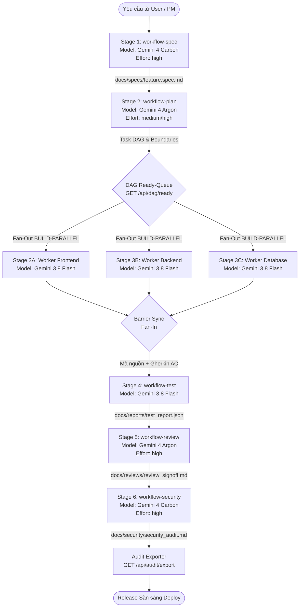

# Hướng Dẫn Chuỗi Workflow Liên Hoàn (Chained Multi-Agent Pipeline)

Tài liệu chi tiết về cơ chế bàn giao Input/Output, định tuyến mô hình 4 tầng (**4-Tier Intelligent Model Routing**), hàng đợi sẵn sàng DAG tự động, và nghiệm thu kiểm toán giữa các agent trong đội ngũ phát triển.

---

## 1. Nguyên Lý Thiết Kế Cốt Lõi

Thay vì nạp toàn bộ lịch sử chat hàng nghìn dòng vào từng subagent (gây loãng ngữ cảnh, hallucination và lãng phí token), hệ thống áp dụng 4 nguyên lý bất biến:
1. **Pointers Over Copies:** Agent trước tạo ra một tập tin kết quả (Artifact). Agent sau chỉ được cấp đường dẫn URI con trỏ tới tập tin đó (`file:///...`).
2. **Hợp Đồng Dữ Liệu Nghiêm Ngặt:** Mỗi giai đoạn có cấu trúc thư mục quy chuẩn (`docs/specs`, `docs/plans`, `docs/reports`, `docs/reviews`, `docs/security`).
3. **Định Tuyến Model 4 Tầng Thông Minh:**
   - ✦ **Gemini 4 Carbon** (`gemini-4-carbon`, `reasoning_effort: high`): Dành cho Stage 1 (Spec PRD phức tạp) và Stage 6 (Kiểm toán bảo mật chuyên sâu OWASP/Auth/Crypto).
   - ✦ **Gemini 4 Argon** (`gemini-4-argon`, `reasoning_effort: medium/high`): Dành cho Stage 2 (Kiến trúc & Task DAG) và Stage 5 (Review chất lượng 5 trục).
   - ⚡ **Gemini 3.8 Flash** (`gemini-3.8-flash`): Dành cho Stage 3 (Parallel Builder) và Stage 4 (Automated Testing), tối ưu tốc độ và tiết kiệm hơn 70% chi phí.
   - ⚡ **Gemini 3.8 Flash-Lite** (`gemini-3.8-flash-lite`): Dành cho telemetry micro-tier và linting nhanh.
4. **Phân Tách Phạm Vi File Tuyệt Đối (Decoupled File Scope Invariant):** Các worker thực thi song song trong Stage 3 chỉ được phép chỉnh sửa các file thuộc phạm vi được giao, tuyệt đối không ghi đè lên file của worker khác.

---

## 2. Bản Đồ 6 Giai Đoạn (Chained Pipeline Graph)



---

## 3. Danh Sách Thư Mục Artifacts Quy Chuẩn

Mỗi dự án sau khi chạy `./install.sh` sẽ duy trì cấu trúc tài liệu đồng nhất:
```
docs/
├── specs/       # Nơi lưu trữ tài liệu đặc tả (Output Stage 1 - Gemini 4 Carbon)
├── plans/       # Nơi lưu trữ kiến trúc kỹ thuật & Task DAG (Output Stage 2 - Gemini 4 Argon)
├── reports/     # Nơi lưu trữ kết quả kiểm thử tự động JSON (Output Stage 4 - Gemini 3.8 Flash)
├── reviews/     # Nơi lưu trữ biên bản nghiệm thu code review (Output Stage 5 - Gemini 4 Argon)
└── security/    # Nơi lưu trữ báo cáo quét bảo mật OWASP (Output Stage 6 - Gemini 4 Carbon)
```

---

## 4. Chi Tiết Từng Giai Đoạn

| Giai Đoạn | Tên Slash Command | Persona | Model Khuyến Nghị | Mức Tư Duy | Artifact Đầu Ra |
| :---: | :--- | :--- | :---: | :---: | :--- |
| **Stage 1** | `/workflow-spec` | `spec-engineer` | ✦ **Gemini 4 Carbon** | `high` | `docs/specs/{feature_id}.spec.md` |
| **Stage 2** | `/workflow-plan` | `task-planner` | ✦ **Gemini 4 Argon** | `high` | `docs/plans/{feature_id}.plan.md` |
| **Stage 3** | `/workflow-build` | `builder` (1..N) | ⚡ **Gemini 3.8 Flash** | `None` | Mã nguồn trên các file tách biệt |
| **Stage 4** | `/workflow-test` | `test-engineer` | ⚡ **Gemini 3.8 Flash** | `None` | `docs/reports/test_report.json` |
| **Stage 5** | `/workflow-review` | `code-reviewer` | ✦ **Gemini 4 Argon** | `high` | `docs/reviews/review_signoff.md` |
| **Stage 6** | `/workflow-security`| `security-auditor`| ✦ **Gemini 4 Carbon** | `high` | `docs/security/security_audit.md` |

---

## 5. Vận Hành Trong Phiên Làm Việc Antigravity (`agy`)

### 5.1 Sử Dụng Slash Commands Tương Tác
Trong khung chat của Antigravity CLI, bạn chỉ cần gõ `/`:
- `/orchestrator`: Khởi chạy toàn bộ hệ thống điều phối, kiểm tra trạng thái dashboard.
- `/workflow-pipeline`: Chạy pipeline liên hoàn xuyên suốt từ Spec đến Security.
- `/workflow-spec`: Chỉ định agent làm rõ yêu cầu thành spec với Gemini 4 Carbon.
- `/workflow-plan`: Lập kế hoạch kiến trúc và chia task song song với Gemini 4 Argon.
- `/workflow-build`: Cho phép các worker implement code song song theo kế hoạch.
- `/workflow-test`: Chạy bộ test kiểm thử tự động với Gemini 3.8 Flash.
- `/workflow-review`: Thực hiện review 5 trục chất lượng với Gemini 4 Argon.
- `/workflow-security`: Thực hiện quét bảo mật sâu với Gemini 4 Carbon.

### 5.2 Sử Dụng CLI Telemetry & Ready-Queue (`client.py`)
```bash
# 1. Đề xuất model tối ưu
python3 packages/orchestrator/client.py recommend --agent security-auditor --complexity critical --security-impact

# 2. Khám phá các task đã sẵn sàng chạy trong DAG
python3 packages/orchestrator/client.py next-ready

# 3. Cập nhật task kèm theo mức tư duy reasoning-effort
python3 packages/orchestrator/client.py update \
  --task SEC-01 \
  --agent security-auditor \
  --model gemini-4-carbon \
  --effort high \
  --status running \
  --progress 30 \
  --scope "Threat Modeling" \
  --notes "Analyzing cryptographic keys and OWASP Top 10"

# 4. Xuất biên bản nghiệm thu kiểm toán nhiệm vụ
python3 packages/orchestrator/client.py export --format markdown --out docs/reports/mission_audit_report.md
```

### 5.3 Theo Dõi Live Trên Web Dashboard
Mở trình duyệt tại: `http://localhost:8484` để theo dõi:
- Tiến độ từng worker theo thời gian thực (Server-Sent Events).
- Biểu đồ DAG trực quan bằng SVG thể hiện luồng phụ thuộc giữa các task.
- Huy hiệu Obsidian Emerald cho **Gemini 4 Carbon** và nhãn nhịp đập (`pulse`) cho các tác vụ tư duy sâu `reasoning_effort: high`.
- Bảng kê chi phí và số lượng token chi tiết theo từng model (USD & VNĐ).
- Tải về nhanh báo cáo kiểm toán Markdown chỉ với 1 click.
