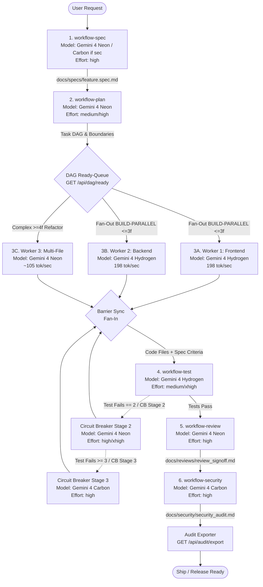

# End-to-End Multi-Agent Pipeline Workflow

## 1. Pipeline Overview & Handoff Graph

This workflow orchestrates the complete software delivery lifecycle across 6 sequential and parallel stages, passing **file pointers instead of raw context** to keep subagents focused and hallucination-free. It leverages the **Periodic Table SWE Fleet Routing matrix** featuring **Gemini 4 Neon** (`~105 tok/s`, Coding Agent Index #1 `58.64`, `xhigh`) as the primary SWE Brain (non-security specs, planning, 5-axis review, debugging, multi-file builders `>= 4` files, and CB Stage 2), **Gemini 4 Hydrogen** (`198 tok/s`, `xhigh`) for bounded parallel building (`<= 3` files) and testing (~24% quota saved), and **Gemini 4 Carbon** (`high`) strictly for Stage 6 security audits, Rule 1 critical tasks, and Circuit Breaker Stage 3 (`retry >= 3`).



---

## 2. Stage-by-Stage Input/Output Contract Summary

| Stage | Workflow File | Persona | Model Engine | Reasoning Effort | Input Pointer | Output Artifact |
| :---: | :--- | :--- | :---: | :---: | :--- | :--- |
| **1** | [`workflow-spec.md`](./workflow-spec.md) | `spec-engineer` | 🖥️ **Desktop** *(if `ready == true`)* / ⚡✦ **Neon** *(✦ Carbon if security)* | `high` | User request & codebase context | `docs/specs/{feature_id}.spec.md` |
| **2** | [`workflow-plan.md`](./workflow-plan.md) | `task-planner` | 🖥️ **Desktop** *(if `ready == true`)* / ⚡✦ **Gemini 4 Neon** | `medium` / `high` | `docs/specs/{feature_id}.spec.md` | `docs/plans/{feature_id}.plan.md` |
| **3** | [`workflow-build.md`](./workflow-build.md) | `builder` (1..N) | 🖥️ **Desktop** *(<=1 heavy/group if `ready == true`)* + ⚡ **Hydrogen** (`<=3` files) / ⚡✦ **Neon** (`>=4` files) | `medium` / `high` / `xhigh` | Task slice from `.plan.md` | Code changes on disjoint files (`$0.00` / `198` / `~105` tok/s) |
| **4** | [`workflow-test.md`](./workflow-test.md) | `test-engineer` | ⚡ **Gemini 4 Hydrogen** | `medium` (`xhigh` retry 1) | Code + Gherkin AC from `.spec.md` | `docs/reports/test_report.json` |
| **5** | [`workflow-review.md`](./workflow-review.md) | `code-reviewer` | 🖥️ **Desktop** *(if `ready == true`)* / ⚡✦ **Gemini 4 Neon** | `high` | Git Diff + `.plan.md` + test report | `docs/reviews/review_signoff.md` |
| **6** | [`workflow-security.md`](./workflow-security.md) | `security-auditor`| ✦ **Gemini 4 Carbon** *(Rule 1 Locked)* | `high` | Code diff + `review_signoff.md` | `docs/security/security_audit.md` |

---

## 3. Orchestrator Dispatch Protocol (How to Chain)

When running the pipeline, the Orchestrator invokes subagents sequentially and in parallel using pointer references:

### Step 0: Pre-Flight Desktop Gate, Conditional 60% Peer Allocation & Smart Routing
Run the **Pre-Flight Detection Gate** (`desktop-doctor` / `GET /api/desktop/status`) before dispatching the pipeline:
- **When Gemini Desktop App IS installed & ready (`ready == true` on macOS or Windows)**: `gemini-desktop-app` operates as a **first-class peer model** (`mode="task"`, `background=True`, `allow_edits=True/False`, `0` focus switches, `$0.00` AGY API token spend) prioritized for **~60% of total SWE workload** (`ORCHESTRATOR_DESKTOP_SHARE=0.60`):
  - Sequential heavy stages (`spec-engineer`, `task-planner`, `code-reviewer`, `debugger`, `performance-auditor`, `doc-generator`) + **at most 1 heavy builder per parallel `parallel_group`** (so `Gemini.app`'s single-window FIFO lock NEVER blocks concurrent Fan-Out!).
  - Remaining **~40%** runs concurrently on AGY API (`gemini-4-hydrogen` `198 tok/s` for sibling parallel builders/testers/scouts, `gemini-4-neon` spillover when Desktop queue is busy, and `gemini-4-carbon` `high` strictly locked on Rule 1 Security Audits).
- **When Gemini Desktop App is NOT installed or NOT ready (`ready == false`, e.g., missing app or locked screen)** — or `--no-desktop` / `--api-only` is passed: Automatically and seamlessly falls back **100% to the pure API fleet (`Gemini 4 Neon` + `Gemini 4 Hydrogen` + `Gemini 4 Carbon` + `Gemini 3.8 Flash`)** just as before!

```bash
# 1. Pre-flight detection gate & 60% conditional peer DAG allocation
python3 packages/orchestrator/client.py desktop-doctor --json
ORCHESTRATOR_DESKTOP_SHARE=0.60 python3 packages/orchestrator/client.py allocate-dag \
  --target-desktop-share 0.60 \
  --apply
# REST equivalent: POST /api/router/allocate-dag

# 2. Override to force 100% pure API fleet fallback
python3 packages/orchestrator/client.py allocate-dag --no-desktop --apply
# or: python3 packages/orchestrator/client.py allocate-dag --api-only --apply

# 3. Query per-task Smart Router recommendation
python3 packages/orchestrator/client.py recommend \
  --agent builder \
  --complexity medium \
  --budget-mode speed_first \
  --retry-count 0
```

### Step 1 ➔ Step 2 Handoff:
```python
# Orchestrator invokes task-planner with the path to the spec:
invoke_subagent(
    typeName="task-planner",
    Role="Architect & Task Planner",
    Model="neon",  # Gemini 4 Neon (~105 tok/sec, #1 Coding Agent)
    Prompt="""
Read the approved specification at file:///path/to/docs/specs/{feature_id}.spec.md.
Design the system architecture, component boundaries, database schemas, and create docs/plans/{feature_id}.plan.md
with a complete task DAG, parallel groups, and Periodic Table SWE model assignments according to workflow-plan.
"""
)
```

### Step 2 ➔ Step 3 Automated DAG Ready-Queue Discovery & Parallel Fan-Out:
Before dispatching builder workers, query the DAG ready queue to find all unblocked tasks:
```bash
python3 packages/orchestrator/client.py next-ready
```

When 2 or more tasks are ready simultaneously, dispatch them concurrently in the same turn:
```python
# Orchestrator dispatches bounded parallel builders (<= 3 files) on Gemini 4 Hydrogen:
invoke_subagent(
    typeName="builder",
    Role="Frontend Builder Worker",
    Model="hydrogen",  # Gemini 4 Hydrogen (198 tok/sec)
    Prompt="""
Execute Task BUILD-01 from file:///path/to/docs/plans/{feature_id}.plan.md.
Scope is strictly limited to frontend/src/components/....
Report progress and tokens via python3 packages/orchestrator/client.py update --task BUILD-01 --model gemini-4-hydrogen --reasoning-effort high.
"""
)

invoke_subagent(
    typeName="builder",
    Role="Backend Builder Worker",
    Model="hydrogen",  # Gemini 4 Hydrogen (198 tok/sec)
    Prompt="""
Execute Task BUILD-02 from file:///path/to/docs/plans/{feature_id}.plan.md.
Scope is strictly limited to backend/api/....
Report progress and tokens via python3 packages/orchestrator/client.py update --task BUILD-02 --model gemini-4-hydrogen --reasoning-effort high.
"""
)
```
*(When `ready == true`, at most **1 heavy builder slice per `parallel_group`** may be allocated to `gemini-desktop-app` with `mode="task"`, `background=True`, `allow_edits=True`, while sibling parallel slices run concurrently on `gemini-4-hydrogen` `198 tok/s` or `gemini-4-neon` spillover `>= 4` files. When `ready == false` or `--no-desktop` / `--api-only` is set, all builder slices run 100% on the pure API fleet.)*

### Step 3 ➔ Step 4 Barrier Sync & Test Execution:
Wait until all tasks in the parallel group report `status == "completed"` in SQLite (`packages/orchestrator/orchestrator.db`), then dispatch `test-engineer` on **Gemini 4 Hydrogen**.

### 3-Stage Fast-Retry & Circuit Breaker Protocol:
- **Stage 1 (`retry_count == 1`)**: Allow **1 fast self-healing turn** on `gemini-4-hydrogen` with `reasoning_effort: xhigh`.
- **Stage 2 (`retry_count == 2`)**: Escalate to **Gemini 4 Neon** (`reasoning_effort: high`, or `xhigh` if `complexity == "high"`; ~2x faster & 32% lower cost than Carbon).
- **Stage 3 (`retry_count >= 3`) or Security Impact**: **Trip the circuit breaker hard**: auto-escalate the task to **Gemini 4 Carbon** (`reasoning_effort: high`) for final frontier root-cause diagnosis.

### Step 4 ➔ Step 5 ➔ Step 6 Verification Gate:
- Pass `docs/reports/test_report.json` to `code-reviewer` (⚡✦ **Gemini 4 Neon**, `effort: high`).
- If review status is `APPROVED`, pass `docs/reviews/review_signoff.md` to `security-auditor` with ✦ **Gemini 4 Carbon** (`reasoning_effort: high`).
- Zero downgrade invariant: Security checks NEVER downgrade to lower tiers, even in `speed_first` or `cost_saving` modes.

### Post-Mission Step: Audit Export
Export the permanent mission audit report:
```bash
python3 packages/orchestrator/client.py export --format markdown --out docs/reports/mission_audit_report.md
```
