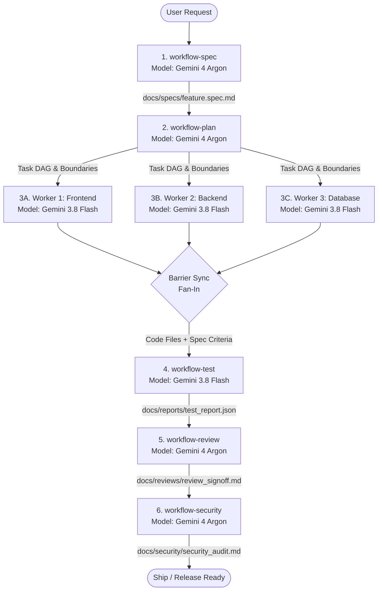

# End-to-End Multi-Agent Pipeline Workflow

## 1. Pipeline Overview & Handoff Graph

This workflow orchestrates the complete software delivery lifecycle across 6 sequential and parallel stages, passing **file pointers instead of raw context** to keep subagents focused and hallucination-free.



---

## 2. Stage-by-Stage Input/Output Contract Summary

| Stage | Workflow File | Persona | Model Engine | Input Pointer | Output Artifact |
| :---: | :--- | :--- | :---: | :--- | :--- |
| **1** | [`workflow-spec.md`](./workflow-spec.md) | `spec-engineer` | ✦ **Gemini 4 Argon** | User request & codebase context | `docs/specs/{feature_id}.spec.md` |
| **2** | [`workflow-plan.md`](./workflow-plan.md) | `task-planner` | ✦ **Gemini 4 Argon** | `docs/specs/{feature_id}.spec.md` | `docs/plans/{feature_id}.plan.md` |
| **3** | [`workflow-build.md`](./workflow-build.md) | `builder` (1..N) | ⚡ **Gemini 3.8 Flash** | Task slice from `.plan.md` | Code changes on disjoint files |
| **4** | [`workflow-test.md`](./workflow-test.md) | `test-engineer` | ⚡ **Gemini 3.8 Flash** | Code + Gherkin AC from `.spec.md` | `docs/reports/test_report.json` |
| **5** | [`workflow-review.md`](./workflow-review.md) | `code-reviewer` | ✦ **Gemini 4 Argon** | Git Diff + `.plan.md` + test report | `docs/reviews/review_signoff.md` |
| **6** | [`workflow-security.md`](./workflow-security.md) | `security-auditor`| ✦ **Gemini 4 Argon** | Code diff + `review_signoff.md` | `docs/security/security_audit.md` |

---

## 3. Orchestrator Dispatch Protocol (How to Chain)

When running the pipeline, the Orchestrator invokes subagents sequentially and in parallel using pointer references:

### Step 1 ➔ Step 2 Handoff:
```python
# Orchestrator invokes task-planner with the path to the spec:
invoke_subagent(
    typeName="task-planner",
    Role="Architect & Task Planner",
    Model="pro",  # Gemini 4 Argon
    Prompt="""
Read the approved specification at file:///home/andrew/hospital-suite/docs/specs/{feature_id}.spec.md.
Design the system architecture, component boundaries, database schemas, and create docs/plans/{feature_id}.plan.md
with a complete task DAG, parallel groups, and model engine assignments according to workflow-plan.
"""
)
```

### Step 2 ➔ Step 3 Parallel Fan-Out:
```python
# Orchestrator dispatches parallel builders in the same turn:
invoke_subagent(
    typeName="builder",
    Role="Frontend Builder Worker",
    Model="flash",  # Gemini 3.8 Flash
    Prompt="""
Execute Task BUILD-01 from file:///home/andrew/hospital-suite/docs/plans/{feature_id}.plan.md.
Scope is strictly limited to frontend/src/components/....
Report progress and tokens via tools/orchestrator/client.py.
"""
)

invoke_subagent(
    typeName="builder",
    Role="Backend Builder Worker",
    Model="flash",  # Gemini 3.8 Flash
    Prompt="""
Execute Task BUILD-02 from file:///home/andrew/hospital-suite/docs/plans/{feature_id}.plan.md.
Scope is strictly limited to backend/api/....
Report progress and tokens via tools/orchestrator/client.py.
"""
)
```

### Step 3 ➔ Step 4 Barrier Sync:
Wait until all tasks in the parallel group report `status == "completed"` in the SQLite database (`tools/orchestrator/orchestrator.db`), then dispatch `test-engineer`.

### Step 4 ➔ Step 5 ➔ Step 6 Verification Gate:
- Pass `docs/reports/test_report.json` to `code-reviewer`.
- If review status is `APPROVED`, pass `docs/reviews/review_signoff.md` to `security-auditor`.
- If any stage reports failures, escalate to `debugger` (Gemini 4 Argon) before repeating.
