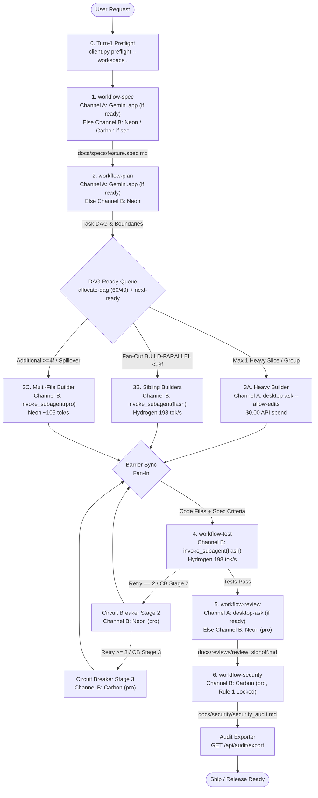

# End-to-End Multi-Agent Pipeline Workflow

## 1. Pipeline Overview & Dual-Channel Handoff Graph

This workflow orchestrates the complete software delivery lifecycle across 6 sequential and parallel stages, passing **file pointers instead of raw context** to keep workers focused and hallucination-free.

After running **Turn-1 `client.py preflight`**, when Gemini Desktop App is ready (`EXECUTION_MODE: HYBRID_60_DESKTOP`), **~60% of the pipeline** (sequential heavy synthesis in Stages 1, 2, 5 + max 1 heavy builder slice per `BUILD-PARALLEL` wave) executes via **Channel A (`run_command` `WaitMsBeforeAsync=500` -> `client.py desktop-ask`, `$0.00` AGY API spend, `0` focus switches)**, while **~40%** executes concurrently on **Channel B (`invoke_subagent`)**: **Gemini 4 Hydrogen** (`Model="flash"`, `198 tok/s`) for sibling parallel builders/testers and **Gemini 4 Carbon** (`Model="pro"`) strictly for Stage 6 Rule 1 security audits and Circuit Breaker Stage 3. When Desktop is unavailable (`API_ONLY_100`), all 6 stages route seamlessly to `invoke_subagent`.



---

## 2. Stage-by-Stage Dual-Channel Input/Output Contract Summary

| Stage | Workflow File | Persona | Primary Channel (`HYBRID_60_DESKTOP`) | `API_ONLY_100` Fallback (`invoke_subagent`) | Input Pointer | Output Artifact |
| :---: | :--- | :--- | :--- | :---: | :--- | :--- |
| **0** | `preflight` | `orchestrator` | `run_command`: `client.py preflight --workspace .` | Same (`API_ONLY_100`) | User request | `EXECUTION_MODE` + 60/40 plan |
| **1** | [`workflow-spec.md`](./workflow-spec.md) | `spec-engineer` | 🖥️ **Channel A**: `desktop-ask` *(if non-security)* | `Model="pro"` (Neon / Carbon if sec) | User request & scout pointers | `docs/specs/{feature_id}.spec.md` |
| **2** | [`workflow-plan.md`](./workflow-plan.md) | `task-planner` | 🖥️ **Channel A**: `desktop-ask` | `Model="pro"` (Neon) | `docs/specs/{feature_id}.spec.md` | `docs/plans/{feature_id}.plan.md` |
| **3** | [`workflow-build.md`](./workflow-build.md) | `builder` (1..N) | 🖥️ **Channel A** *(max 1 heavy/group, `--allow-edits`)* + ⚡ **Channel B** `invoke_subagent(Model="flash")` | `Model="flash"` (`<=3` files) / `Model="pro"` (`>=4` files) | Task slice from `.plan.md` | Code changes on disjoint files |
| **4** | [`workflow-test.md`](./workflow-test.md) | `test-engineer` | ⚡ **Channel B**: `invoke_subagent(Model="flash")` | `Model="flash"` (Hydrogen) | Code + Gherkin AC from `.spec.md` | `docs/reports/test_report.json` |
| **5** | [`workflow-review.md`](./workflow-review.md) | `code-reviewer` | 🖥️ **Channel A**: `desktop-ask` *(if non-security)* | `Model="pro"` (Neon / Carbon if sec) | Git Diff + `.plan.md` + test report | `docs/reviews/review_signoff.md` |
| **6** | [`workflow-security.md`](./workflow-security.md) | `security-auditor` | ✦ **Channel B**: `invoke_subagent(Model="pro")` *(Rule 1 Locked on Carbon)* | `Model="pro"` (Carbon) | Code diff + `review_signoff.md` | `docs/security/security_audit.md` |

---

## 3. Dual-Channel Orchestrator Dispatch Protocol

### Step 0: Mandatory Turn-1 Pre-Flight Gate
Execute `preflight` as the very first action on Turn 1:
```bash
python3 ~/.gemini/tools/orchestrator/client.py preflight --workspace .
# Or with pre-registered tasks / JSON task list:
python3 ~/.gemini/tools/orchestrator/client.py preflight --tasks-json tasks.json --apply --workspace .
# Force 100% AGY API fleet when needed:
python3 ~/.gemini/tools/orchestrator/client.py preflight --no-desktop --workspace .
```
- **When `EXECUTION_MODE: HYBRID_60_DESKTOP`**:
  **HARD INVARIANT**: Do NOT dispatch `spec-engineer`, `task-planner`, `code-reviewer`, `doc-generator`, non-critical `debugger`, or the wave's primary heavy `builder` to AGY `pro`/`inherit` `invoke_subagent`! Dispatch them to **Channel A (`desktop-ask`)** via `run_command(WaitMsBeforeAsync=500)`.
- **When `EXECUTION_MODE: API_ONLY_100`**:
  Dispatch 100% of tasks via `invoke_subagent` (`Model="pro"`/`"inherit"` for Neon/Carbon roles, `Model="flash"` for Hydrogen/Flash roles).

### Step 1 ➔ Step 2 Dual-Channel Handoff:
When `HYBRID_60_DESKTOP` is active, dispatch `task-planner` via **Channel A** (`run_command`, `WaitMsBeforeAsync=500`, omit `--allow-edits` for read-only planning synthesis, or write the resulting artifact after reactive wakeup):
```bash
python3 ~/.gemini/tools/orchestrator/client.py desktop-ask \
  --task PLAN-01 \
  --agent task-planner \
  --workspace . \
  --output docs/reports/desktop_worker/PLAN-01.md \
  --prompt "Read docs/specs/{feature_id}.spec.md. Design system architecture, component boundaries, database schemas, and produce the complete task DAG, parallel groups, and disjoint file contracts for docs/plans/{feature_id}.plan.md."
```
*(Fallback in `API_ONLY_100` mode: `invoke_subagent(TypeName="task-planner", Role="Architect and Task Planner", Model="pro", Prompt=...)`.)*

### Step 2 ➔ Step 3 Automated 60/40 DAG Allocation & Concurrent Dual-Channel Fan-Out:
Before dispatching Stage 3 builders, run `allocate-dag` + `next-ready`:
```bash
python3 ~/.gemini/tools/orchestrator/client.py allocate-dag --target-desktop-share 0.60 --apply
python3 ~/.gemini/tools/orchestrator/client.py next-ready
```

When multiple tasks in `BUILD-PARALLEL` are ready simultaneously, launch **Channel A** (`run_command` `WaitMsBeforeAsync=500`, max 1 heavy builder with `--allow-edits`) AND **Channel B** (`invoke_subagent(Model="flash")` for sibling bounded builders) **concurrently in the same turn**:

1. **Channel A — Primary Heavy Builder (Max 1 per `parallel_group`, via `run_command` `WaitMsBeforeAsync=500`)**:
```bash
python3 ~/.gemini/tools/orchestrator/client.py desktop-ask \
  --task BUILD-01 \
  --agent builder \
  --workspace . \
  --allow-edits \
  --prompt "Execute BUILD-01 from docs/plans/{feature_id}.plan.md. Scope is strictly limited to <DISJOINT_HEAVY_FILES>. Run local compile/syntax checks and summarize diffs."
```

2. **Channel B — Sibling Parallel Builders & Testers (`invoke_subagent(Model="flash")`, launched in same turn)**:
```python
invoke_subagent(
    TypeName="builder",
    Role="Sibling API Builder Worker",
    Model="flash",  # Gemini 4 Hydrogen (198 tok/s)
    Prompt="""
Execute Task BUILD-02 from file:///path/to/docs/plans/{feature_id}.plan.md.
Scope is strictly limited to <DISJOINT_SIBLING_FILES>.
Report progress and tokens via python3 ~/.gemini/tools/orchestrator/client.py update --task BUILD-02 --agent builder --status completed --progress 100 --model gemini-4-hydrogen --reasoning-effort high.
"""
)
```
*(When `API_ONLY_100` is active, dispatch all builder slices via `invoke_subagent` — `Model="flash"` for `<=3` files and `Model="pro"` for `>=4` files.)*

### Step 3 ➔ Step 4 Barrier Sync & Test Execution:
Wait via reactive wakeup until Channel A (`run_command` completion) and Channel B (`send_message`) workers finish and report `status == "completed"` in SQLite, then dispatch `test-engineer` via **Channel B**: `invoke_subagent(TypeName="test-engineer", Role="Test Specialist", Model="flash", ...)` (`gemini-4-hydrogen`).

### 3-Stage Fast-Retry & Circuit Breaker Protocol (Channel B API Only):
- **Stage 1 (`retry_count == 1`)**: `invoke_subagent(Model="flash")` (`gemini-4-hydrogen`, `reasoning_effort: xhigh`).
- **Stage 2 (`retry_count == 2`)**: `invoke_subagent(Model="pro")` (`gemini-4-neon`, `reasoning_effort: high`/`xhigh`).
- **Stage 3 (`retry_count >= 3`) or Security Impact**: `invoke_subagent(Model="pro")` (`gemini-4-carbon`, `reasoning_effort: high`).

### Step 4 ➔ Step 5 ➔ Step 6 Verification Gate:
- **Stage 5 (`workflow-review`)**: When `HYBRID_60_DESKTOP` and non-security, dispatch `code-reviewer` via **Channel A (`client.py desktop-ask`, read-only — omit `--allow-edits`)**; otherwise `invoke_subagent(Model="pro")` (`gemini-4-neon`).
- **Stage 6 (`workflow-security`)**: If review status is `APPROVED`, **ALWAYS** dispatch `security-auditor` via **Channel B `invoke_subagent(Model="pro")`** (`gemini-4-carbon`, Rule 1 locked — never downgraded and never offloaded to Desktop).

### Post-Mission Step: Audit Export
```bash
python3 ~/.gemini/tools/orchestrator/client.py export --format markdown --out docs/reports/mission_audit_report.md
```
